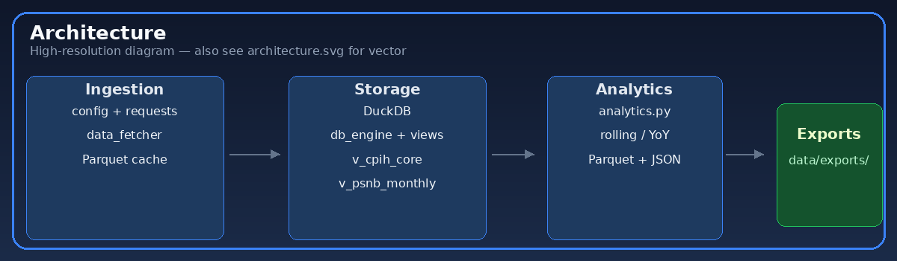

# uk-macro-analytics-engine

<picture>
  <source srcset="./hero.webp" type="image/webp" />
  
</picture>

A small, production-minded **Python 3.11+** pipeline that downloads **open UK macroeconomic**
CSVs, validates shape and column names, caches **Parquet** locally, loads into **DuckDB**,
and runs **vectorized SQL** analytics (rolling windows, year-over-year inflation, fiscal totals).

## Architecture

**Diagram (PNG)** — works in the GitHub web README, **mobile app**, and clients that block inline **SVG**.

<picture>
  <source srcset="./architecture.webp" type="image/webp" />
  
</picture>

_Assets are exported at **~2×** the display width above (then downscaled by the browser) so they stay sharp on **Retina / high-DPI** screens; **WebP** is still the default for speed, with **full-color PNG** fallbacks._

**Vector source (for decks / print):** [`architecture.svg`](./architecture.svg).

**Plain text (always renders):**

```
  [ Ingestion: config, requests, data_fetcher, Parquet cache ]
                            |
                            v
  [ DuckDB: db_engine, views v_cpih_core, v_psnb_monthly ]
                            |
                            v
  [ analytics.py: rolling windows, YoY, exports ]
                            |
                            v
  [ data/exports: .parquet + .json ]
```

**Editable diagram (Mermaid source):** [`docs/architecture.mmd`](./docs/architecture.mmd)

GitHub **mobile** and many other viewers **never** render ` ```mermaid ` blocks in README files—they always show the raw text (as in your screenshot). The **PNG / WebP** diagram above is the portable diagram; use the `.mmd` file in [Mermaid Live Editor](https://mermaid.live) or a desktop IDE when you want the interactive version.

## Tech stack

| Layer | Choice |
|-------|--------|
| Language | Python **3.11+** (also tested on **3.12**) |
| Analytics / OLAP | **DuckDB** with indexes and pragmatic PRAGMAs |
| Tabular IO | **pandas** + **pyarrow** (Parquet) |
| HTTP | **requests** with retries |
| Testing | **pytest** |
| CI | **GitHub Actions** (audit → compile → tests) |
| Edge / Workers | No hard dependency on a specific host. Pure Python **stdlib + wheels**; for **Cloudflare Workers** use a **Python compat** or **container** pattern—this repo is CLI-first. |

## Project layout

```
.
├── hero.webp
├── hero.png
├── architecture.webp
├── architecture.png
├── architecture.svg
├── docs/
│   └── architecture.mmd    # Mermaid source (use mermaid.live / IDE; not mobile README)
├── .github/workflows/ci.yml
├── src/
│   ├── __init__.py
│   ├── config.py          # URLs, paths, DuckDB settings
│   ├── data_fetcher.py    # download + cache + validation
│   ├── db_engine.py       # DuckDB connect, views, indexes
│   ├── analytics.py       # queries + exports
│   └── security_audit.py  # lightweight static checks
├── tools/
│   ├── regen_readme_images.py   # rebuild WebP + PNG README assets
│   └── source/                  # optional high-res sources (hero.png, architecture.png)
├── tests/test_pipeline.py
├── requirements.txt
├── LICENSE
├── NOTICE.md
└── README.md
```

## Getting started

### Prerequisites

- **Python 3.11+**
- Network access for dataset downloads (or use your own Parquet by wiring a custom `DatasetSpec`).

### Install

```bash
python -m venv .venv
source .venv/bin/activate          # Windows: .venv\Scripts\activate
pip install -r requirements.txt
```

### Quickstart (CLI)

**1) Fetch one dataset to the Parquet cache**

```bash
python -m src.data_fetcher ons_cpih_monthly
python -m src.data_fetcher ons_psnb_monthly
```

**2) Run the full analytics pipeline** (downloads if needed, loads DuckDB, prints previews, exports)

```bash
python -m src.analytics
```

Exports are written under `data/exports/`:

- `cpih_yoy.parquet` / `cpih_yoy.json`
- `psnb_monthly.parquet` / `psnb_monthly.json`

Use `--no-export` on `analytics` to skip writing files.

## Configuration

- **Dataset URLs and expected columns**: `src/config.py` (`DATASETS` mapping).
- **DuckDB tuning**: `DuckDBSettings` in the same file (`threads`, `memory_limit`, etc.).
- **Cache location**: `data/cache/parquet/` (created automatically).

If a publisher changes CSV layout, update the **`DatasetSpec`** or extend **`_alias_key_columns`** in `data_fetcher.py`.

## Security & compliance

- **Dependency hygiene**: requirements are **version-pinned**; CI runs `src/security_audit.py` to flag **insecure `git+http`** deps and other risky patterns.
- **Secrets**: Do not commit API keys; the audit script flags common risky literals.
- **Legal — software**: This codebase is released under the **MIT License** (see `LICENSE`).
- **Legal — data**: UK public-sector datasets are often under the **Open Government Licence (OGL)**. See `NOTICE.md` and each publisher’s terms. This project does **not** grant rights to third-party data; you must attribute and comply with the relevant licence when redistributing **derived** statistics or charts.

## Continuous integration

Workflow: `.github/workflows/ci.yml`

1. `python src/security_audit.py`
2. `python -m compileall -q src tests`
3. `pytest -q --tb=short`

## Tests

```bash
pytest -q
```

## Hero image

Images are built for **HiDPI**: files are **~2×** the `width`/`height` shown in the `` tags so they stay sharp on Retina displays, while **WebP** stays the default for smaller transfer. **PNG** fallbacks are full-color. Regenerate after edits:

```bash
pip install pillow
python3 tools/regen_readme_images.py
```

Optional: drop a wide master banner as `tools/source/hero.png` (the script upscales to **1800px** width if your source is smaller). The architecture bitmap is redrawn in code for crisp lines; use [`architecture.svg`](./architecture.svg) for lossless vector in slides.

## Licence

Code: **MIT** — see `LICENSE`. Data: governed by publisher licences (see `NOTICE.md`).
